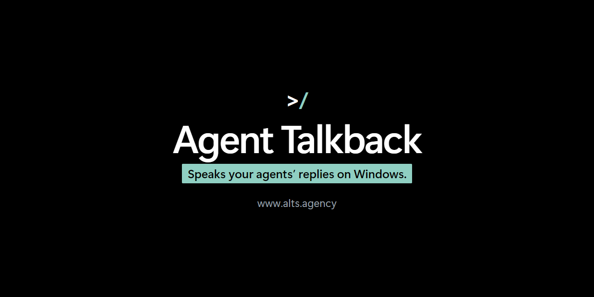

# Agent Talkback



Agent Talkback reads your AI agents' replies out loud on Windows 10 and 11. Your agent sends the reply text when it
finishes a turn. Talkback picks the part worth hearing, picks the voice, and speaks it. You switch it off from the tray
when you are in a meeting. If you run several agents, each folder an agent works in can have its own voice.

It works with Claude Code, Codex, Hermes Agent and any script that can run a command or send an HTTP request. Your
reply text goes only to your text-to-speech providers: the one you choose, and the ones it falls back to if that fails.

Both providers it ships with have free voice models: HeyGen Voice on OpenRouter and Orpheus on Groq. One key from
either is enough. With no key at all, Microsoft Edge's voice speaks for free.

## Install

You need Windows 10 or 11, [Git](https://git-scm.com/download/win) and
[Python 3.10 or newer](https://www.python.org/downloads/windows/) from python.org (its `tkinter` draws the setup
window). In PowerShell or Command Prompt:

```bat
git clone https://github.com/alts-agency/agent-talkback.git C:\tools\talkback
cd C:\tools\talkback
py -m venv .venv
.venv\Scripts\python -m pip install -r requirements.txt
.venv\Scripts\python console.py
```

The examples below use `C:\tools\talkback`. If you clone somewhere else, change the paths to match.

To update an existing install, run `git pull` in the Talkback folder, then quit Talkback from the tray and start it
again. Your settings and keys stay as they are.

The last command opens the setup window:

1. In the provider table, click **Edit** on OpenRouter (or Groq) and paste your key from
   [openrouter.ai](https://openrouter.ai/keys) (or [console.groq.com](https://console.groq.com/keys)). The key is
   saved in `secrets\`, never in `settings.json`. Skip this step to use only the free Microsoft voice.
2. Under **Primary voice**, click **Change** and press **Test** on a few voices. Click a voice to use it.
3. Turn on **Start with Windows** if you want Talkback running after every login.
4. Close the window. Talkback stays in the tray. Its menu item **Open console** brings the window back.

To start Talkback without the window, run `.venv\Scripts\pythonw talkback.py`.

## Use with your agent

Your agent runs `send.py` when it finishes a reply and hands it the text. `send.py` posts the text to Talkback, starts
Talkback if it is not running, and exits. It never blocks your agent and never makes it fail. If speaking is off,
the reply is dropped.

Talkback saves the Python it runs on as `pythonw` in `settings.json`, and `send.py` starts it with that one. After
Talkback has started once, any Python can run `send.py`. Before then, `send.py` uses the `pythonw.exe` next to the
Python that ran it, which needs the packages, so the examples below use the Python inside `.venv`.

`send.py` takes the reply in three ways:

- `--text "the reply"` on the command line
- hook JSON on stdin, with the reply in `last_assistant_message`, `response`, `message` or `extra.assistant_response`
- hook JSON as the last argument, with the reply in `last-assistant-message` (what Codex sends)

### Claude Code

Add a Stop hook to `%USERPROFILE%\.claude\settings.json`, or to a project's `.claude\settings.json`. Claude Code sends
the reply on stdin as `last_assistant_message`.

```json
{
  "hooks": {
    "Stop": [
      {
        "hooks": [
          {
            "type": "command",
            "command": "C:\\tools\\talkback\\.venv\\Scripts\\python.exe",
            "args": ["C:\\tools\\talkback\\send.py", "--source", "claude"],
            "timeout": 15,
            "async": true
          }
        ]
      }
    ]
  }
}
```

If the file already has a `hooks` section, add the `Stop` entry to it.

A Claude Code background session (`claude --bg`), such as a helper that another agent started, is never spoken. A tool
that starts helpers in a terminal can keep them quiet by creating `%USERPROFILE%\.cchelper\<session id>.json`.

### Codex

Add this line to `%USERPROFILE%\.codex\config.toml`, above any `[section]`. Codex runs the `notify` command after each
turn and passes the reply as a JSON argument. It allows one `notify` command, so this replaces any you already have.

```toml
notify = ['C:\tools\talkback\.venv\Scripts\python.exe', 'C:\tools\talkback\send.py', '--source', 'codex']
```

### Hermes Agent

[Hermes Agent](https://github.com/NousResearch/hermes-agent) runs
[shell hooks](https://hermes-agent.nousresearch.com/docs/user-guide/features/hooks) from the `hooks:` block in
`%USERPROFILE%\.hermes\config.yaml`. Its `post_llm_call` event fires once per finished turn and pipes the reply to the
hook as `extra.assistant_response`.

```yaml
hooks:
  post_llm_call:
    - command: 'C:\tools\talkback\.venv\Scripts\python.exe C:\tools\talkback\send.py --source hermes'
      timeout: 15
```

The first time `hermes chat` sees a new hook it asks you to approve it. The gateway never asks, so if you only run
the gateway, start it once with `--accept-hooks`.

### Any other agent or script

Run `send.py` with the text:

```bat
C:\tools\talkback\.venv\Scripts\python.exe C:\tools\talkback\send.py --source myagent --text "Build finished, all tests pass."
```

Or post to Talkback directly. It answers `202` when the reply is queued:

```powershell
Invoke-RestMethod -Method Post -Uri http://127.0.0.1:47800/say -ContentType application/json `
  -Body '{"text": "Build finished, all tests pass.", "source": "ci"}'
```

### Choose what is spoken

Talkback speaks from a `**In short:**` paragraph to the end of the `**From you:**` paragraph after it. A reply
without that header is spoken whole when it is short and plain. Otherwise Talkback speaks its first sentence or two.
Replies are spoken one at a time.

To get the short version every time, add one line to your agent's instructions file (`AGENTS.md`, `CLAUDE.md` or
similar):

> Start every reply with a one-paragraph `**In short:**` summary. Add a `**From you:**` paragraph when you need
> something from me.

### What each agent sends

| Agent | How the reply arrives | Folder that gets the voice |
|---|---|---|
| Claude Code | hook JSON on stdin, `last_assistant_message` | the project folder (`CLAUDE_PROJECT_DIR`) |
| Codex | hook JSON as the last argument, `last-assistant-message` | the `cwd` in the JSON, else the current folder |
| Hermes Agent | hook JSON on stdin, `extra.assistant_response` | the `cwd` in the JSON, else the current folder |
| Your script | `--text` | the current folder |
| Plain HTTP | `text` in `POST /say` | none, unless you add `talker` |

If `CLAUDE_PROJECT_DIR` is set, any hook uses it.

## A voice for each agent folder

The first time `send.py` sends from a folder, it writes `.talkback.json` there:

```json
{"id": "<a new random UUID>", "name": "<the folder's name>"}
```

Open **Voices by Agent** in the setup window and click **Change** to see your folders. A folder appears after its first
spoken reply, shown by the last two parts of its path, with the most recent first.

- With its switch off, a folder gets an automatic voice. Talkback picks it from the `voices` list of the primary
  provider's voice set in use, based on the id, so it stays the same. It differs from your primary voice when the list
  has another voice. Two folders can get the same one, and changing the list changes the picks.
- With the switch on, you choose any provider, model and voice from the menu, your primary voice included. The menu
  plays no sample. The choice stays when you change the primary voice. Replies go to that provider first. If it fails,
  the usual order follows. If you remove the provider, model or voice, the folder goes back to the automatic voice and
  the window says so. Switching off forgets the choice.

`send.py` never rewrites the file, so the id survives a folder rename. Commit the file to git if you want the same
project to keep one voice on two computers. Leave it out (add it to `.gitignore`) and each clone or worktree counts as
a new agent. If the folder cannot be written, or the file cannot be read, the reply uses your primary voice and the
file is left as it is. When you send by hand, a subfolder counts as its own agent.

Talkback keeps the list in `settings.json` as `talkers`. Past 200 folders, it drops the one unheard for longest, never
one you changed.

## The tray icon

The icon is the Alts Agency chevron: white when Talkback speaks, grey when it is off.

- Left-click switches speaking on or off at once. While it is off, replies are dropped, not saved for later. It is on
  again after every restart. Hover over the icon to see the voice in use and whether it is on.
- Right-click opens the menu. **Agent Talkback** is ticked while it speaks; click it to switch. Below it are
  `Running` or `Not running`, **Primary Voice** (provider, voice set, voice), **Open console**,
  **Interrupt current**, **Reload settings** and **Quit**. The provider and voice in use are ticked. The Microsoft
  backup voice is chosen in the console, not in the tray.
- **F9** also stops the reply being spoken.
- If you start Talkback while it is already running, the second copy says so and points to the tray icon. A copy
  started by `send.py` stays silent (`--quiet`), so your agent never waits on a message box.

## The setup window

`console.py` follows Windows' light or dark mode.

- **Primary voice** is tried first for every reply. **Change** shows its voices as tiles, three to a line. Click a tile
  to use that voice; it is tinted and ticked. The **Test** strip at the foot of a tile speaks a line in that voice
  without choosing it.
- **Backup voice** is Microsoft Edge's voice engine. It needs no key and speaks when the primary voice fails.
  **Change** shows Microsoft's English (`en-`) voices as the same tiles, with a box to filter them.
- The provider table lists your providers by name. **Set as primary** makes a provider speak first. **Edit** opens its
  name, endpoint, key and **Models**. **+ Add provider** adds any OpenAI-compatible speech endpoint.
- **+ Add model**, in the Edit dialog, adds another voice model on the same endpoint and key, such as
  `fish-audio/s2.1-pro-free:free` on OpenRouter. Each model has **Edit** and **Remove** (the last one cannot be removed).
  Nothing is saved until you press **Save**. The table then shows `+1` after the model, and **Change** has a tab for each
  model, with `(Primary)` on the one in use.
- **Voices by Agent** is for people who run several agents: see [A voice for each agent folder](#a-voice-for-each-agent-folder).
- **Talkback Voice** switches speaking on and off, the same as the tray icon. **Start with Windows** starts Talkback
  when you log in. **Desktop shortcut** puts a shortcut to this window on your desktop, and switching it off
  deletes the shortcut again.
- **alts.agency** at the top right opens our website.

The window has a fixed size. Accent colours were checked for contrast in light and dark mode.

## Keys

Keys live in `secrets\`, one file per provider, named after it (`openrouter.local`, `groq.local`). The folder is in
`.gitignore`, so no key is in this repository. Keys never go into `settings.json`, the log or the status page.
Talkback reads the key file at every reply, so a new key works without a restart. To keep a key in an environment
variable instead, set the provider's `key` to `env:NAME`.

## Voices in settings.json

`settings.json` is created on first start. Its `sources` list holds the providers. A source is one endpoint and one
key. Its `sets` are voice sets: one model each, with the voice in use and the voices the tray offers.

```json
{"id": "groq", "label": "Groq", "engine": "openai", "set": "Orpheus",
 "base_url": "https://api.groq.com/openai/v1", "key": "file:secrets/groq.local",
 "sets": [{"name": "Orpheus", "model": "canopylabs/orpheus-v1-english", "voice": "autumn",
           "voices": ["autumn", "diana", "hannah", "austin", "daniel", "troy"], "request_limit": 200}]}
```

- The primary voice speaks first. If it has no key or fails, the free Microsoft voice speaks, then the other
  providers in the order they appear in `settings.json`. The setup window lists them alphabetically and only changes
  which one is primary. A new install tries `OpenRouter > HeyGen`, then `Free (for Windows) > Microsoft Edge`, then
  `Groq > Orpheus`.
- `set` is the voice set in use. One source can hold several sets with different models, so one OpenRouter key can
  speak HeyGen and another model, and the tray switches between them.
- `request_limit` belongs to a voice set. It is the most characters that model takes in one request. Longer text is
  split and fetched in parallel.
- `format` is optional and also belongs to a voice set: `wav` (the default) or `pcm`. HeyGen Voice speaks only `pcm`,
  and its shipped set says so. If a provider refuses the format, Talkback asks once more in the other format.
- `key` points to the key: `file:secrets/openrouter.local` (what the setup window writes) or
  `env:OPENROUTER_API_KEY`. A relative path is read from the Talkback folder.
- `engine` is `openai` for any OpenAI-compatible `/audio/speech` endpoint (OpenRouter, Groq or your own), `cartesia`
  for Cartesia's own `/tts/bytes` endpoint, or `microsoft` for edge-tts. For `cartesia`, `base_url` is
  `https://api.cartesia.ai` and a voice is an id or a name, which Talkback looks up once. **+ Add provider** creates
  `openai` providers, so add Cartesia by editing `settings.json`.
- A source without a key is skipped. The setup window shows its key as `Not set` and the tray says `(no key)`.
- Talkback reads at most 5 sources and 8 voice sets per source. Raise `MAX_SOURCES` and `MAX_SETS` at the top of
  `talkback.py` to use more. Anything past the limit is ignored with one line in the log.
- `settings.json` is at version 3. It also holds `enabled`, `port`, `primary` (the id of the source that speaks
  first), `talkers` (your agent folders: name, the last two parts of the path, chosen voice, first and last time heard)
  and `pythonw` (the Python that `send.py` starts Talkback with). Files from older versions are upgraded on start and
  keep their voices and key files.

## HTTP interface

Talkback listens on `http://127.0.0.1:47800`.

| Request | What it does |
|---|---|
| `POST /say` with `{"text": "...", "source": "..."}` | queues a reply (`202`). `"only": "<source id>"` speaks it with that one source, which is how **Test** works |
| `GET /status` | the settings without keys, `talkers` or `pythonw`, and how many replies are waiting |
| `POST /reload` | reads `settings.json` again |
| `POST /enabled` with `{"enabled": false}` | switches speaking off or on and updates the tray |

A reply can name its agent folder, so it gets that folder's voice:
`"talker": {"id": "<a UUID>", "name": "...", "folder": "..."}`.

## Files

| File | What it is |
|---|---|
| `talkback.py` | the program (run it with `pythonw`) |
| `console.py` | the setup window |
| `send.py` | the sender your agent calls |
| `settings.json` | your voices (created on first start, not in git) |
| `secrets\` | your keys, one file per provider, not in git |
| `.talkback.json` | written by `send.py` in each agent folder: its id and name |
| `talkback.log` | one line per reply: who sent it, which part was spoken, which voice. Never the text |
| `social/preview.html` | the source of the GitHub preview image |

The program file is still called `talkback.py`, so hooks set up for earlier versions keep working.

## Security

The server listens on `127.0.0.1` only. It refuses a foreign `Host` or `Origin`, accepts only `application/json`, caps
a request at 100 KB and the queue at 24 replies, and never returns a key or its path. `send.py` writes
`.talkback.json` in agent folders and reads Claude Code's job files to find background sessions. See
[SECURITY.md](SECURITY.md) for the trust model and how to report a problem.

## Credits

Made by [Max Tiong](https://github.com/mkraeborn) and [Alts Agency](https://alts.agency). The chevron is the Alts
Agency mark. The setup window, icons and preview image were made for this release and are under the MIT licence.

## Licence

MIT. See [LICENSE](LICENSE).
